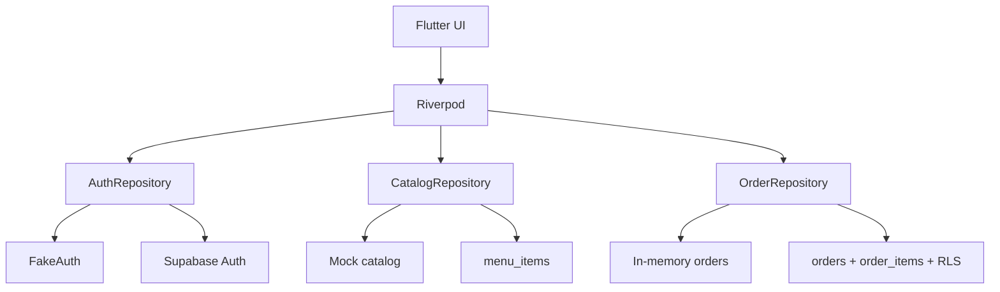

# BiteBox

[](https://flutter.dev)
[](https://riverpod.dev)
[](https://supabase.com)
[](LICENSE)
[](pubspec.yaml)

A **from-scratch** Flutter food-delivery MVP for a single virtual kitchen.

Browse the menu → add to cart → checkout → orders.  
**Mock** mode works offline (guest checkout). **Supabase** mode adds Auth + Postgres + RLS (sign-in required for Checkout / Orders).

[Demo video (MP4)](docs/screenshots/fiverr/demo_video.mp4)

## Screenshots

| Menu | Product | Cart |
| :---: | :---: | :---: |
|  |  |  |

| Checkout | Orders | Sign in |
| :---: | :---: | :---: |
|  |  |  |

More platform crops (Instagram / Chengjubao) and capture notes: [`docs/screenshots/README.md`](docs/screenshots/README.md).  
Architecture diagram: [`docs/screenshots/architecture.png`](docs/screenshots/architecture.png).

## Features

- Single-store menu (burger / pizza / drink / dessert) with search + category chips  
- Product details, session cart, guest checkout in Mock mode  
- Order history with payment-method snapshot  
- Email/password auth UI (Fake local or Supabase Auth)  
- Route guards for Checkout / Orders when `BACKEND_MODE=supabase`  
- **en / zh** UI (follow system with English fallback, or lock language from the home AppBar)  

## Architecture

```text
UI (features/*/presentation)
  → Riverpod Notifiers / FutureProviders
    → Repository interfaces
      → Mock / Fake  or  Supabase implementations
```



Feature-first folders under `lib/features/{auth,catalog,cart,checkout,orders}` plus shared `lib/app` and `lib/core`.

## Quick start (Mock)

```bash
flutter pub get
flutter run --dart-define=BACKEND_MODE=mock
```

```bash
flutter test
```

## Supabase mode

1. Create a Supabase project  
2. Run `supabase/migrations/20261110190000_bitebox_menu_and_orders.sql`  
3. Copy `.vscode/supabase.example.json` → `.vscode/supabase.local.json` and fill your project URL + anon key  
4. Prefer disabling email confirmation for local demos  

```bash
flutter run --dart-define-from-file=.vscode/supabase.local.json
```

In Supabase mode, **Checkout** and **Orders** require sign-in.

Details: [`supabase/README.md`](supabase/README.md) · live checklist: [`docs/SUPABASE_LIVE_CHECKLIST.md`](docs/SUPABASE_LIVE_CHECKLIST.md)

## Limitations (MVP honesty)

- Simulated payment only; fixed Demo delivery address; cart is **in-memory** (cleared on process kill)  
- Order insert is not a DB transaction (orders then order_items; no automatic rollback)  
- No order-detail page; status does not advance after place-order  
- Menu images are category placeholders (not per-dish photography)  
- Forgot password / Google / Apple are Coming soon placeholders  
- Supabase **API smoke** is covered; full Flutter UI acceptance against a live project is maintainer-side  

## Chinese market note

This demo uses **email + password** for overseas clients (Fiverr / Upwork).  
For the Chinese market, the same architecture can be adapted to phone OTP + WeChat login.

## Attribution

Independent implementation by Zhiguo Ye (Samye).  
Design tokens and commerce-flow ideas were studied against open-source delivery apps (including **FlowDelivery**, MIT) for learning. See [`LICENSE`](LICENSE).

## License

MIT — see [`LICENSE`](LICENSE).
